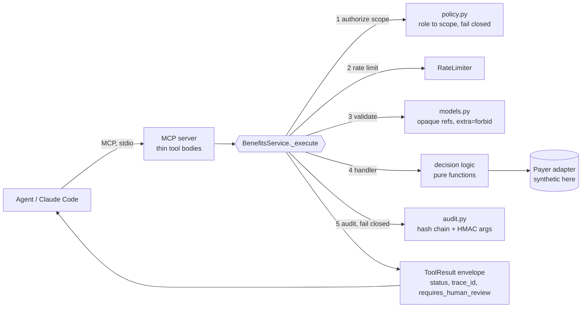
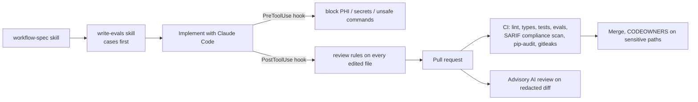

# Architecture

## Request path

Order matters: authorization happens before validation so an unauthorized caller learns nothing
about the schema; audit is written last so the recorded outcome is the real one, and a failed
audit write converts the result into an error with no data.

## Key decisions

| Decision | Why | Where |
|---|---|---|
| Tools accept `pt_*` / `clm_*` references only | The model cannot leak what it never receives | [ADR 0001](adr/0001-opaque-references.md) |
| Tool parameters are plain `str`; validation is in the service | Framework-level validation errors can echo the rejected value into model context | `mcp_server/server.py` |
| One guarded path for all tools | Cross-cutting controls cannot be forgotten per tool | `service.py`, rule AUD001 |
| Hash-chained audit with HMAC'd args | Tamper evidence without storing payloads | `audit.py` |
| Logs go to stderr through a scrubbing filter | stdout is the MCP protocol channel; logs are a classic PHI leak | `phi.py` |
| Deterministic decision logic, escalate unknowns | A wrong "no auth needed" costs a denied claim or a compliance issue | `payer_sim.evaluate_prior_auth` |
| Gate = deterministic rules; LLM = advisory | Reproducible, explainable, no vendor dependency for the gate | [ADR 0002](adr/0002-deterministic-gate-advisory-llm.md) |

## Engineering workflow

## Extending

- **New tool**: add a `Scope`, map it to the narrowest role in `policy.ROLE_SCOPES`, add a
  request model, a handler and a thin tool in `server.py` that calls `svc.<method>`, then add
  eval cases. The review bot rejects a tool that does not delegate to the service.
- **Real payer**: implement the `Payer` protocol (`lookup_member`, `prior_auth_rule`) over a
  clearinghouse (X12 270/271 and 278 or a payer FHIR API) and keep the same envelope.
- **Durable execution**: long waits (payer follow-up, human approval) belong in a Temporal
  workflow; see the `temporal-workflow-scaffold` skill.
